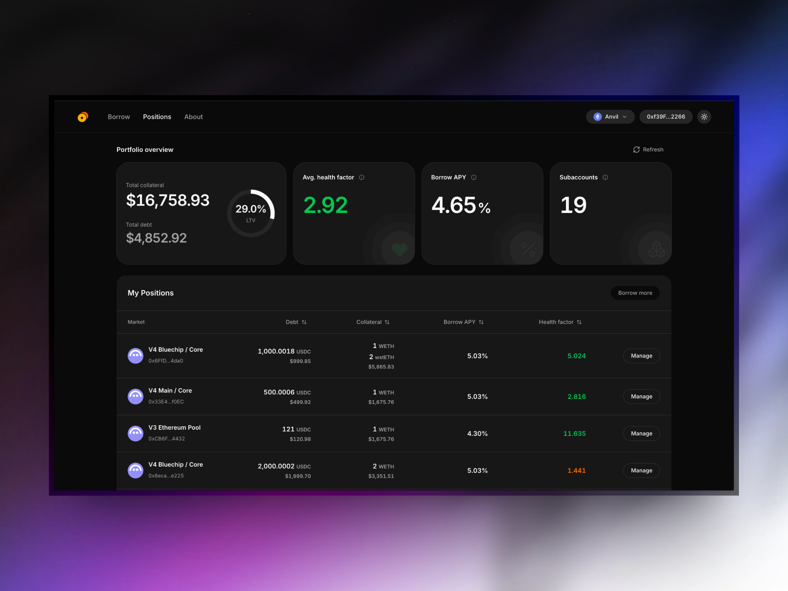

# Aave Isolated Positions

Borrow across Aave V3 and V4 markets using separate, owner-controlled position accounts. Compare borrowing rates, supply multiple collateral assets, and manage each position independently.



## Overview

- Compare eligible V3 and V4 markets for your collateral and loan asset.
- Create separate accounts with their own collateral, debt, and risk limits.
- Track positions, add or withdraw collateral, repay debt, and close accounts.

The current execution environment is a local Ethereum fork.

## Getting started

Requires Node.js 24+, pnpm 12.18+, Foundry, and `jq`.

```sh
pnpm install
pnpm fork
```

Keep the fork running. In another terminal:

```sh
pnpm local:deploy
pnpm local:fund
pnpm indexer:sync
pnpm dev
```

Open [localhost:3210/31337](http://127.0.0.1:3210/31337) and select **Connect wallet → Anvil Local** to use a funded test account. See [local development](docs/local-development.md) for additional configuration.

## Project structure

| Directory | Purpose |
| --- | --- |
| `apps/web` | Next.js borrowing interface and position dashboard |
| `contracts` | Solidity position accounts, factory, adapters, and tests |
| `apps/indexer` | Optional Envio indexer for position and activity history |

## Contract coverage

Measured from the Solidity unit suite on November 27, 2026.

| Lines | Statements | Branches | Functions |
| ---: | ---: | ---: | ---: |
| 81.04% | 75.23% | 39.06% | 86.96% |

See [coverage methodology and gaps](docs/benchmarks.md#contract-coverage).

## Gas benchmarks

Measured across 28 successful scenarios using Foundry 1.7.1, Solidity 0.8.24, Cancun, and the optimizer at 200 runs. V3 and V4 use the same single-collateral workload for comparison.

Factory deployment: **3,154,674 gas**, measured separately from position creation.

| Operation | V3 gas | V4 gas |
| --- | ---: | ---: |
| Create account and supply collateral | 2,599,542 | 2,616,668 |
| Create account, supply, and borrow | 2,671,213 | 2,693,237 |
| Add to existing collateral | 118,441 | 116,190 |
| Withdraw part of the collateral | 99,464 | 96,325 |
| Borrow more | 102,631 | 106,153 |
| Repay part of the debt | 120,122 | 115,611 |
| Repay all debt and refund excess funding | 122,744 | 118,232 |
| Repay all debt and withdraw all collateral | 175,058 | 170,359 |
| Add collateral and borrow in one batch | 177,705 | 179,372 |
| Recover idle tokens | 51,364 | 51,364 |

| V4 basket and configuration operation | Gas |
| --- | ---: |
| Create account with two collateral assets | 2,711,062 |
| Create account with two collateral assets and borrow | 2,786,874 |
| Add a second collateral asset | 145,853 |
| Repay all debt and withdraw both collateral assets | 218,135 |
| Disable one collateral asset | 63,360 |
| Enable one collateral asset | 67,300 |
| Refresh configuration and risk premium | 49,691 |

Management starts with 10 collateral tokens and 2 debt tokens; the V4 basket adds 5 tokens of a second collateral. Partial changes use 1 token. Full repayment funds 3 debt tokens to include the excess-funding refund path; closure funds the exact 2-token debt.

These are isolated execution measurements against mock protocols. V4 refresh uses no-op mock update methods, so its result measures account and adapter overhead. Live Aave costs, wallet approvals, and transaction fees are outside these results. The V3 fixture supports one collateral asset; V3 basket and collateral-toggle scenarios are not measured.

```sh
pnpm --filter @aave-isolated/contracts test:gas
pnpm --filter @aave-isolated/contracts test:gas:check
```

See [methodology and scenario details](docs/benchmarks.md#gas-benchmarks), the [benchmark suite](contracts/test/GasBenchmarks.t.sol), and the [saved gas baseline](contracts/snapshots/GasBenchmarks.json).

## Testing

Run from the repository root:

```sh
pnpm typecheck
pnpm test
pnpm check:contracts
pnpm build
```

[Coverage and gas reports](docs/benchmarks.md) include commands to reproduce the published measurements. [Verification notes](docs/verification.md) record native fork and browser checks.

## Documentation

- [Architecture](docs/architecture.md)
- [Domain model](docs/domain-model.md)
- [Protocol sources](docs/protocol-sources.md)
- [Deployment manifests](contracts/config/README.md)
- [Indexer](apps/indexer/README.md)
- [UI components](apps/web/src/components/ui/README.md)
